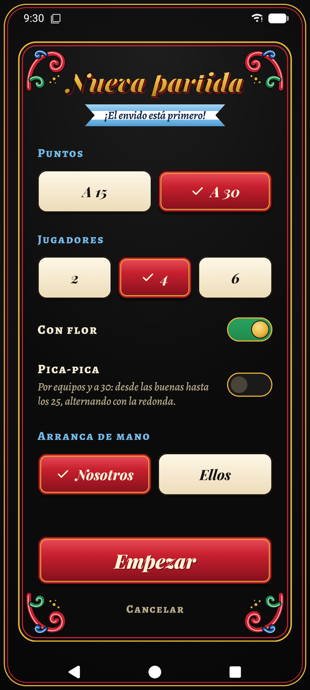
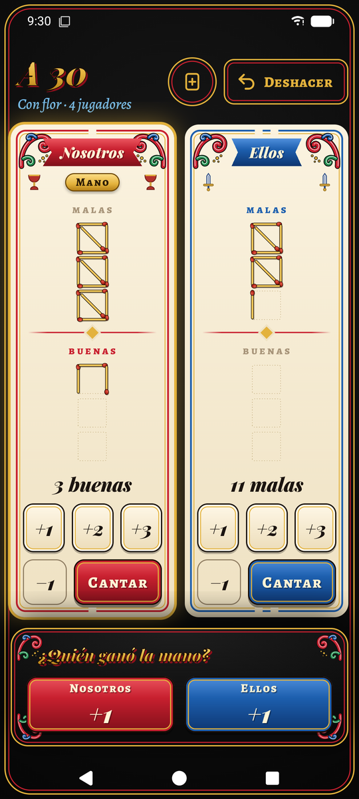
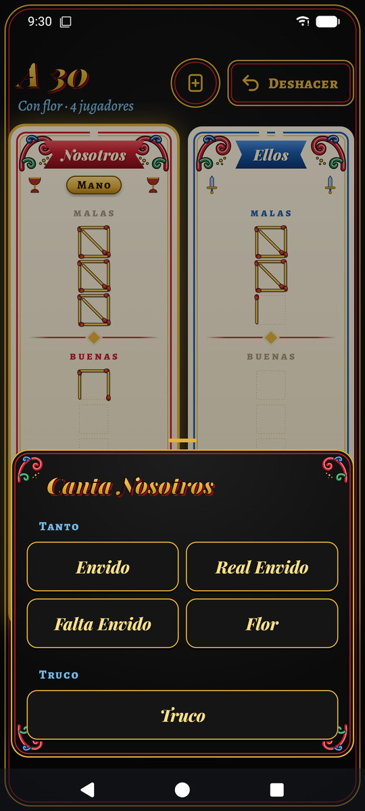
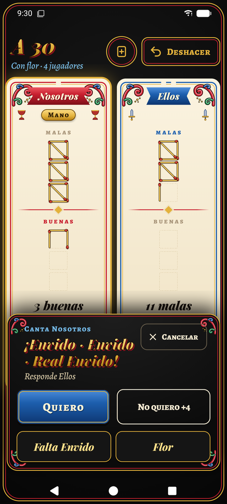
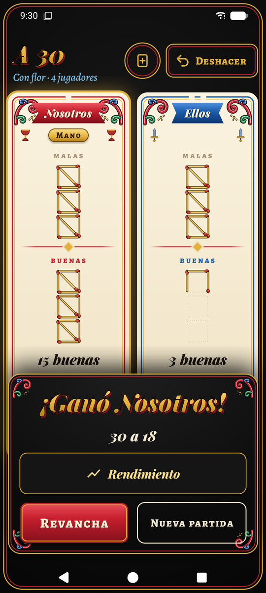
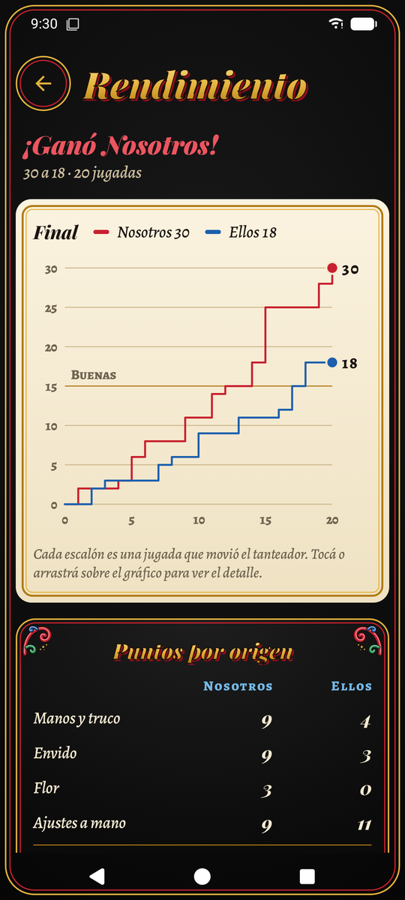

# Truco — anotador de truco argentino

App de Android para anotar partidas de truco en la mesa. No reparte cartas ni juega: lleva el tanteador con casitas de fósforos y guía los cantos (envido, flor, truco y sus subidas) para que nadie tenga que hacer cuentas.

Hecha en Kotlin con Jetpack Compose, con un estilo visual de **fileteado porteño**: un naipe español pintado como cartel de bodegón.

## Capturas

<table>
  <tr>
    <td align="center" width="33%"><br><sub><b>Nueva partida</b>: a cuánto, cuántos y con qué reglas</sub></td>
    <td align="center" width="33%"><br><sub><b>La partida</b>: casitas de fósforos, malas y buenas</sub></td>
    <td align="center" width="33%"><br><sub><b>Cantar</b>: solo aparece lo que se puede cantar</sub></td>
  </tr>
  <tr>
    <td align="center"><br><sub><b>El asistente</b>: quién responde y cuánto vale cada opción</sub></td>
    <td align="center"><br><sub><b>Fin de la partida</b>: revancha con un toque</sub></td>
    <td align="center"><br><sub><b>Rendimiento</b>: cómo se llegó al resultado</sub></td>
  </tr>
</table>

## Qué hace

- **Partidas a 15 o a 30**, con malas y buenas cuando se juega a 30.
- **2, 4 o 6 jugadores**, con **pica-pica** opcional en las partidas por equipos.
- **Con o sin flor.**
- **Asistente de cantos**: al cantar, la app muestra quién responde, qué puede subir y cuánto vale el *quiero* y el *no quiero*. Calcula sola la falta envido y la contraflor al resto.
- **Casitas de fósforos** animadas, de a cinco puntos.
- **Deshacer** hasta 100 jugadas, incluido empezar una partida nueva por error.
- **Se guarda sola**: si cerrás la app o se apaga el teléfono, la partida sigue donde estaba.
- **Rendimiento al terminar**: gráfico de cómo evolucionó el tanteador, puntos por origen (manos y truco, envido, flor, ajustes a mano) y la mayor ventaja de cada equipo.
- Pantalla siempre encendida, solo vertical y siempre en modo oscuro, porque se usa sobre la mesa y muchas veces de noche.

## Requisitos

| Herramienta | Versión |
|---|---|
| JDK | 17 o superior (el que trae Android Studio sirve) |
| Android SDK | Plataforma 37 (`compileSdk` y `targetSdk`) |
| Android Studio | Una versión compatible con AGP 9.3 |
| Gradle | 9.5.0, lo baja el wrapper |
| Dispositivo | Android 8.0 (API 26) o superior |

Gradle encuentra el SDK por `local.properties` (`sdk.dir=...`). Android Studio crea ese archivo solo; no se versiona.

## Compilar y ejecutar

```bash
# Compilar el APK de debug
./gradlew assembleDebug

# Instalar en el teléfono conectado por USB
./gradlew installDebug

# Instalar el release (R8 + baseline profile): es el que hay que usar para medir rendimiento
./gradlew installRelease

# Tests unitarios
./gradlew testDebugUnitTest
```

El release se firma con la clave de debug a propósito: así `installRelease` se instala encima del debug sin perder la partida guardada. **Para publicar en Google Play hace falta una clave propia** (ver `app/build.gradle.kts`).

Para ver cuánto tarda en arrancar hasta que se puede jugar:

```bash
adb logcat -s ActivityTaskManager | grep -E "Displayed|Fully drawn"
```

`Displayed` es el primer cuadro; `Fully drawn` es cuando ya se leyó la partida guardada.

## Tecnologías

- **Kotlin 2.2** con el soporte de Kotlin integrado en AGP 9.
- **Jetpack Compose** (BOM 2026.02) con Material 3, sin XML de layouts.
- **DataStore** + **kotlinx.serialization** para guardar la partida como JSON.
- **Corrutinas y Flow** para el estado.
- **JUnit 4** para los tests.

No usa librerías de inyección de dependencias ni de navegación: el proyecto es chico y las dos cosas se resuelven a mano en pocas líneas.

## Estructura

```
app/src/main/java/com/apptruco/
├── TrucoApplication.kt   Arranque: crea el repositorio y precarga las fuentes
├── MainActivity.kt       Única actividad: tema y pantalla raíz
├── domain/               Reglas del truco en Kotlin puro (sin Android)
│   ├── model/            Partida, mano, cantos, puntaje, configuración
│   └── rules/            Motor de reglas, puntos de cada canto, estadísticas
├── data/                 Guardado de la partida con DataStore
└── ui/
    ├── game/             Pantalla de la partida, asistente y hoja de cantos
    ├── setup/            Pantalla "Nueva partida"
    ├── performance/      Pantalla de rendimiento y gráfico
    └── theme/            Colores, letras y piezas del fileteado
```

La explicación completa, archivo por archivo, está en la **[Guía del desarrollador](docs/GUIA_DESARROLLADOR.md)**.

## Documentación

| Documento | Para qué |
|---|---|
| [docs/GUIA_DESARROLLADOR.md](docs/GUIA_DESARROLLADOR.md) | Guía de estudio: qué hay en cada parte, cómo fluye una jugada y cómo agregar cosas |
| [CONTRIBUTING.md](CONTRIBUTING.md) | Cómo trabajar en el proyecto: ramas, commits, tests y medición |
| [CHANGELOG.md](CHANGELOG.md) | Historial de cambios |

## Créditos

Las tipografías **Playfair Display**, **Alegreya** y **Alegreya SC** son de Google Fonts y se distribuyen bajo la [SIL Open Font License 1.1](https://openfontlicense.org). Están en `app/src/main/res/font/`.

## Licencia

Todavía no tiene una licencia definida. Hasta que se agregue un archivo `LICENSE`, todos los derechos quedan reservados al autor.
