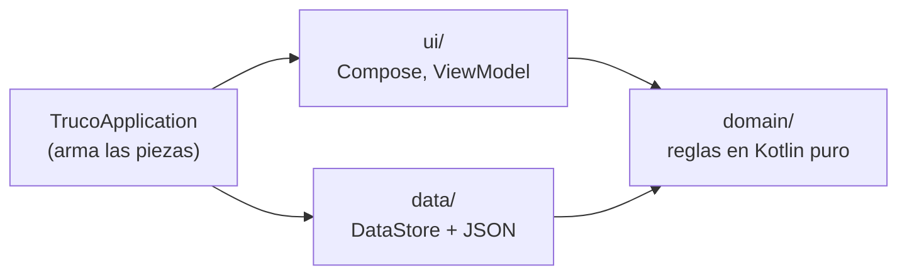
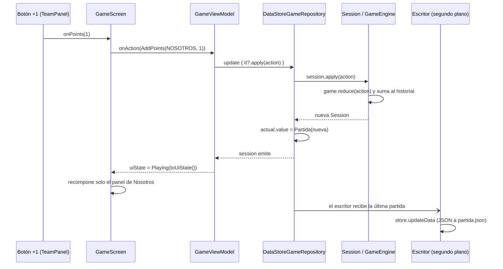

# Guía del desarrollador

Guía de estudio de **AppTruco**: dónde está cada parte del proyecto, para qué sirve y por qué está hecha así. La primera vez conviene leerla de arriba abajo. Después sirve de referencia: cada sección enlaza al código que explica.

> **Qué hace falta saber antes:** Kotlin básico (`data class`, `when`, funciones de extensión, `null`-safety) y nociones de Jetpack Compose (qué es un composable, `remember`, `Modifier`). Lo demás se explica acá.

## Índice

1. [El truco en cinco minutos](#1-el-truco-en-cinco-minutos)
2. [Mapa del proyecto](#2-mapa-del-proyecto)
3. [Arquitectura](#3-arquitectura)
4. [Recorrido de un toque](#4-recorrido-de-un-toque)
5. [Capa por capa](#5-capa-por-capa)
6. [Conceptos para estudiar](#6-conceptos-para-estudiar)
7. [Decisiones de rendimiento](#7-decisiones-de-rendimiento)
8. [Recetas: cómo agregar cosas](#8-recetas-cómo-agregar-cosas)
9. [Trampas conocidas](#9-trampas-conocidas)
10. [Autoevaluación](#10-autoevaluación)
11. [Glosario](#11-glosario)

**Recorrido sugerido:**

| Etapa | Leé | Al terminar deberías poder… |
|---|---|---|
| 1. Contexto | Secciones 1 a 3 | Explicar qué hace la app y en qué capas se divide |
| 2. El corazón | 5.2 a 5.4 y [`GameEngineTest`](../app/src/test/java/com/apptruco/domain/GameEngineTest.kt) | Seguir con el dedo qué pasa con la partida en cada canto |
| 3. El flujo completo | Sección 4, 5.5 y 5.6 | Contar el viaje de un toque desde el botón hasta el disco |
| 4. La pantalla | 5.7 a 5.10 | Encontrar qué composable dibuja cada cosa que se ve |
| 5. A fondo | Secciones 6 a 9 | Agregar una regla o una pantalla sin romper nada |
| 6. Control | Sección 10 | Responder las preguntas sin mirar las respuestas |

---

## 1. El truco en cinco minutos

Si ya jugás al truco, pasá a la [tabla de puntos](#tabla-de-puntos): es lo único que necesitás repasar. Si no, esto es lo mínimo para entender el código.

**La app no juega al truco: lo anota.** No sabe qué cartas tiene nadie. Los jugadores le cuentan lo que pasó en la mesa (quién cantó, quién quiso, quién ganó) y la app suma los puntos.

| Término | Qué es | En el código |
|---|---|---|
| **Partida** | Se juega a 15 o a 30 puntos. Gana el primero que llega. | [`GameConfig.target`](../app/src/main/java/com/apptruco/domain/model/GameConfig.kt) |
| **Malas y buenas** | A 30, los primeros 15 puntos son "las malas" y los otros 15 "las buenas". A 15 no hay buenas. | `GameConfig.malas`, `Scoring.standing()` |
| **Mano** (la ronda) | Cada reparto de cartas. Se gana jugando las cartas; vale 1 punto, o más si se cantó truco. | `Hand` |
| **Mano** (el equipo) | El equipo que juega primero en esa ronda. Desempata el envido y rota cada ronda. | `Hand.mano` |
| **Tanto** | Envido o flor: se canta una sola vez por ronda y se gana por el valor de las cartas. | `Hand.envido`, `Hand.flor`, `Hand.tantoPlayed` |
| **Envido** | Cadena que puede ser Envido, Envido Envido, Real Envido y Falta Envido. | `EnvidoCall` |
| **Flor** | Tres cartas del mismo palo. Solo si la partida es "con flor". Tapa al envido. | `FlorCall`, `GameConfig.withFlor` |
| **Truco** | Apuesta sobre la ronda: Truco, Retruco y Vale Cuatro. Solo sube quien tiene "el quiero". | `TrucoCall` |
| **Querido / no querido** | Al rival que le cantan responde "quiero" (se juega por más) o "no quiero" (el que cantó se lleva lo de antes). | `GameAction.Answer` |
| **El envido está primero** | Si te cantan truco, antes de responder podés cantar envido. Se resuelve el envido y después el truco. | `tantoOpenings()`, orden de `prompt()` |
| **Falta envido** | Se juega lo que le falta a alguien para terminar. Ver más abajo. | `Scoring.falta()` |
| **Pica-pica** | En partidas por equipos a 30: en el medio de la partida se juegan rondas de duelos uno contra uno, alternando con rondas normales ("la redonda"). | `Hand.picaPica`, `Hand.duel`, `Scoring.isPicaPicaZone()` |
| **Casitas** | La forma de anotar con fósforos: cada casita son cuatro lados y una diagonal, o sea cinco puntos. | [`TallyMarks.kt`](../app/src/main/java/com/apptruco/ui/game/TallyMarks.kt) |

### Tabla de puntos

Todo esto está en [`Scoring.kt`](../app/src/main/java/com/apptruco/domain/rules/Scoring.kt).

| Canto | Si se quiere | Si no se quiere |
|---|---|---|
| Envido | 2 | 1 |
| Envido Envido | 4 | 2 |
| Real Envido | 3 | 1 |
| Envido + Real Envido | 5 | 2 |
| Envido Envido + Real Envido | 7 | 4 |
| … + Falta Envido | la falta | lo que valía antes (mínimo 1) |
| Flor | 3 para quien la cantó: no se quiere ni se rechaza, se anota (el rival puede subir a contraflor) | — |
| Contraflor | 6 | 4 (*me achico*) |
| Contraflor al resto | la falta | 6 si antes hubo contraflor; si no, 4 |
| Ronda sin truco | 1 | — |
| Truco | 2 | 1 |
| Retruco | 3 | 2 |
| Vale Cuatro | 4 | 3 |

**La regla general del "no quiero":** el que cantó se lleva lo que valía la apuesta *antes* del último canto. Por eso `envidoNoQuerido` suma todos los cantos menos el último y `trucoNoQuerido` toma los puntos del canto anterior.

**La falta:** si los dos equipos están en las malas, "se juega el partido": el que gana se lleva lo que le falta para terminar. Si alguno ya entró en las buenas, se juega lo que le falta *al que va ganando*. Como depende de quién gane, el asistente muestra un premio distinto para cada equipo (`Prompt.TantoWinner.prizes`).

**Pica-pica:** solo con 4 o 6 jugadores, a 30 y con la opción activada. Arranca cuando alguien entra en las buenas y termina cuando alguien queda a cinco de ganar. En ese tramo se alterna una ronda de pica-pica (2 o 3 duelos, todos con la misma mano) con una redonda.

---

## 2. Mapa del proyecto

```
AppTruco/
├── README.md, CONTRIBUTING.md, CHANGELOG.md
├── docs/
│   ├── GUIA_DESARROLLADOR.md        ← estás acá
│   └── capturas/                    Capturas del emulador que muestra el README
├── settings.gradle.kts              Repositorios y el único módulo, :app
├── build.gradle.kts                 Plugins del proyecto (sin aplicar)
├── gradle.properties                Memoria de Gradle, configuration cache, estilo de Kotlin
├── gradle/libs.versions.toml        Catálogo de versiones: todas las dependencias en un lugar
├── estilos/                         Mockups y renders del estilo visual (no se versiona)
├── dist/                            APK listo para subir a Releases (no se versiona)
└── app/
    ├── build.gradle.kts             SDK, release con R8, firma, dependencias
    └── src/
        ├── main/
        │   ├── AndroidManifest.xml  Application, actividad única, solo vertical
        │   ├── baseline-prof.txt    Qué código se compila antes de usarse
        │   ├── java/com/apptruco/
        │   │   ├── TrucoApplication.kt      Crea el repositorio y precarga las fuentes
        │   │   ├── MainActivity.kt          Pantalla completa, pantalla encendida, tema
        │   │   ├── domain/                  ── REGLAS (Kotlin puro) ──
        │   │   │   ├── GameRepository.kt    Contrato: leer y modificar la sesión
        │   │   │   ├── Session.kt           Partida + historial para deshacer
        │   │   │   ├── model/
        │   │   │   │   ├── Game.kt          Game, Hand y Prompt (qué falta resolver)
        │   │   │   │   ├── Canto.kt         Cantos y Bet (una cadena de cantos)
        │   │   │   │   ├── GameAction.kt    Todo lo que puede pasar en la mesa
        │   │   │   │   ├── GameConfig.kt    A cuánto, cuántos, flor, pica-pica
        │   │   │   │   ├── Score.kt         Puntaje, eventos y malas/buenas
        │   │   │   │   └── Team.kt          Nosotros y Ellos
        │   │   │   └── rules/
        │   │   │       ├── GameEngine.kt    reduce(), cantosFor(), prompt()
        │   │   │       ├── Scoring.kt       Cuánto vale cada canto, la falta, pica-pica
        │   │   │       └── Performance.kt   Estadísticas para el gráfico
        │   │   ├── data/                    ── GUARDADO ──
        │   │   │   ├── SavedState.kt        Lo que va al archivo y cómo se (de)serializa
        │   │   │   └── DataStoreGameRepository.kt  Partida en memoria + escritor a disco
        │   │   └── ui/                      ── PANTALLAS ──
        │   │       ├── game/
        │   │       │   ├── GameViewModel.kt   Estado de pantalla y eventos
        │   │       │   ├── GameUiState.kt     Qué estados de pantalla existen
        │   │       │   ├── GameScreen.kt      GameRoute (navegación) y la partida
        │   │       │   ├── TeamPanel.kt       El naipe de cada equipo
        │   │       │   ├── TallyMarks.kt      Las casitas de fósforos
        │   │       │   ├── CantoAssistant.kt  El cartel de abajo que guía los cantos
        │   │       │   ├── CantoSheet.kt      Hoja para elegir qué cantar
        │   │       │   └── Labels.kt          Textos y colores de equipos y cantos
        │   │       ├── setup/SetupScreen.kt   "Nueva partida"
        │   │       ├── performance/
        │   │       │   ├── PerformanceUiState.kt
        │   │       │   ├── PerformanceScreen.kt
        │   │       │   └── ScoreChart.kt      Gráfico de escalones en Canvas
        │   │       └── theme/
        │   │           ├── Color.kt           Paleta y Tonos de cada equipo
        │   │           ├── Theme.kt           MaterialTheme oscuro y SobreLaCarta
        │   │           ├── Type.kt            Tipografías y precarga
        │   │           ├── Filete.kt          Filetes, cartel, cinta, voluta, letra fileteada
        │   │           └── Botones.kt         Pintura y los cinco tipos de botón
        │   └── res/
        │       ├── drawable/          Íconos vectoriales, palos, voluta, ícono de la app
        │       ├── font/              TTF de Playfair Display, Alegreya y Alegreya SC
        │       ├── mipmap-anydpi/     Ícono adaptable
        │       └── values/            strings.xml (todos los textos) y themes.xml
        └── test/java/com/apptruco/
            ├── domain/GameEngineTest.kt              25 tests de reglas
            └── data/
                ├── SavedStateSerializerTest.kt       Guardar y leer, archivo roto
                └── DataStoreGameRepositoryTest.kt    Mostrar enseguida, guardar después
```

---

## 3. Arquitectura

La app tiene tres capas. La flecha se lee "depende de":



- **`domain/`** no conoce Android. Solo importa `Flow` y `@Serializable`. Por eso las reglas se testean con JUnit común, sin emulador.
- **`data/`** implementa la interfaz `GameRepository` que define `domain/`. La UI nunca ve DataStore.
- **`ui/`** muestra el estado y manda eventos. **No decide ninguna regla**: le pregunta a `domain/` qué se puede cantar (`cantosFor`) y qué hay que resolver (`prompt`).
- **`TrucoApplication`** es la "inyección de dependencias" a mano: crea el repositorio una vez y el ViewModel lo toma de ahí.

### Cinco ideas que sostienen todo

1. **El estado es un valor inmutable.** `Game`, `Hand`, `Bet` y `Session` son `data class` con `val`. Una jugada no modifica la partida: crea una nueva.
2. **Una sola función cambia la partida:** [`Game.reduce(action)`](../app/src/main/java/com/apptruco/domain/rules/GameEngine.kt#L17). Recibe la partida y una acción y devuelve la partida siguiente. Es el patrón *reducer* (el mismo de Redux o MVI).
3. **Una acción que no corresponde devuelve la misma partida.** Si alguien toca "Quiero" sin canto pendiente, `reduce` devuelve `this`. No hay excepciones ni estados inválidos.
4. **Flujo unidireccional.** El estado baja (ViewModel → pantalla → componentes) y los eventos suben como lambdas (`onAction`, `onUndo`…).
5. **Una sola fuente de verdad.** La partida vive en el repositorio. El ViewModel no guarda una copia: la transforma en estado de pantalla.

---

## 4. Recorrido de un toque

Qué pasa cuando alguien toca **+1** en el panel de Nosotros:



Paso a paso, con el código:

1. **El botón.** En [`TeamPanel.kt`](../app/src/main/java/com/apptruco/ui/game/TeamPanel.kt), `PointControls` llama a `onPoints(1)`.
2. **La pantalla arma la acción.** En [`GameScreen.kt`](../app/src/main/java/com/apptruco/ui/game/GameScreen.kt) la lambda es `{ points -> onAction(GameAction.AddPoints(equipo, points)) }`. Captura el `Team` y no el estado del panel, así es la misma lambda entre jugadas (ver [estabilidad](#estabilidad-en-compose)).
3. **El ViewModel delega.** [`GameViewModel.onAction`](../app/src/main/java/com/apptruco/ui/game/GameViewModel.kt#L41) lanza una corrutina con `repository.update { it?.apply(action) }`.
4. **El repositorio aplica la jugada.** [`DataStoreGameRepository.update`](../app/src/main/java/com/apptruco/data/DataStoreGameRepository.kt) se asegura de haber leído el disco, toma un `Mutex` para que dos toques no se pisen y ejecuta la transformación.
5. **El dominio calcula.** [`Session.apply`](../app/src/main/java/com/apptruco/domain/Session.kt#L18) llama a `game.reduce(action)`. Si la partida cambió, guarda la anterior en el historial (máximo 100). Si no cambió, devuelve la misma `Session`.
6. **La partida nueva se publica.** Si la sesión es otra (`nueva !== anterior`), el repositorio la pone en `actual`, un `MutableStateFlow`. El flujo `session` emite.
7. **El ViewModel arma el estado de pantalla.** `uiState` combina la sesión con el destino actual y produce `GameScreenState.Playing(session.toUiState())`.
8. **Compose recompone.** `GameRoute` lee el estado con `collectAsStateWithLifecycle`. Como `TeamUiState` es `@Immutable`, el panel de Ellos se compara por valor, es igual y se saltea.
9. **Las casitas animan.** `TallyMarks` anima de 0 a 1 el fósforo nuevo. El valor animado se lee al *dibujar*, así que en cada cuadro de la animación no hay recomposición.
10. **Se guarda.** Un único escritor, lanzado en el `init` del repositorio, recibe la partida y la escribe con `store.updateData`. Si llegan varias jugadas mientras escribe, `conflate()` se queda con la última.

**Lo importante:** la jugada se ve en el paso 8 sin esperar al disco del paso 10. Antes se esperaba la escritura y cada toque tardaba unos 55 ms más (ver [Decisiones de rendimiento](#7-decisiones-de-rendimiento)).

---

## 5. Capa por capa

### 5.1 Arranque

| Archivo | Qué hace |
|---|---|
| [`AndroidManifest.xml`](../app/src/main/AndroidManifest.xml) | Declara `TrucoApplication` y una sola actividad, fija en vertical. |
| [`TrucoApplication.kt`](../app/src/main/java/com/apptruco/TrucoApplication.kt) | Tiene `gameRepository` (`by lazy`: se crea la primera vez que se pide). En `onCreate` lanza un hilo que precarga las fuentes con `precalentarLetras`. |
| [`MainActivity.kt`](../app/src/main/java/com/apptruco/MainActivity.kt) | Dibuja detrás de las barras del sistema (`enableEdgeToEdge`), deja la pantalla siempre encendida (`FLAG_KEEP_SCREEN_ON`) y monta `TrucoTheme { GameRoute() }`. |
| [`res/values/themes.xml`](../app/src/main/res/values/themes.xml) | Fondo negro de la ventana, para que no haya un destello blanco antes del primer cuadro de Compose. |

### 5.2 Dominio: el modelo

Carpeta [`domain/model/`](../app/src/main/java/com/apptruco/domain/model/). Son datos, casi sin lógica.

**[`Team.kt`](../app/src/main/java/com/apptruco/domain/model/Team.kt)**: `NOSOTROS` y `ELLOS`, con `opponent`. Siempre son dos equipos, aunque jueguen 6.

**[`GameConfig.kt`](../app/src/main/java/com/apptruco/domain/model/GameConfig.kt)**: a cuánto se juega, cuántos jugadores, con flor y pica-pica. El `init` valida con `require`: no puede existir una configuración inválida. Tiene propiedades derivadas: `hasBuenas`, `malas`, `playsPicaPica` (solo si además es a 30 y por equipos) y `duels` (jugadores / 2).

**[`Canto.kt`](../app/src/main/java/com/apptruco/domain/model/Canto.kt)**:
- `Canto` es una `sealed interface` con tres enums: `EnvidoCall`, `FlorCall` y `TrucoCall`. Un `when` sobre `Canto` obliga a cubrir los tres tipos.
- `TrucoCall` lleva los puntos y `next` (el canto que sigue).
- **`Bet<C>`** es la pieza más ingeniosa del modelo: una cadena de cantos del mismo tipo.
  - `calls`: los cantos en orden (por ejemplo `[ENVIDO, ENVIDO, REAL_ENVIDO]`).
  - `caller`: quien cantó *lo último*. Responde siempre el rival (`responder`).
  - `raise(call)` crea una apuesta nueva cantada por el que respondía, sin aceptar, y guarda la actual en `previous`.
  - `previous` es lo que permite **cancelar** un canto apretado por error: se vuelve a la apuesta de antes.

**[`Game.kt`](../app/src/main/java/com/apptruco/domain/model/Game.kt)**:
- `Hand` es la ronda en curso: quién es mano, si es pica-pica y qué duelo, las tres apuestas (`envido`, `flor`, `truco`) y si ya se jugó el tanto.
  - `trucoPoints`: lo que vale la ronda (1, o los puntos del truco querido).
  - `isIdle`: no hay nada pendiente de responder. Solo así se puede anotar quién ganó la ronda.
  - `activeEnvido`: la flor tapa al envido. El envido no se borra: si se cancela la flor, vuelve.
- `Game` es la partida: configuración, ronda, puntaje y `timeline` (cada punto anotado y de dónde vino). `winner` es el primero que llegó al objetivo.
- **`Prompt`** dice qué tiene que resolver la mesa ahora. La UI muestra una cosa distinta para cada caso:

| Prompt | Cuándo | Qué muestra el asistente |
|---|---|---|
| `HandWinner` | No hay nada pendiente | "¿Quién ganó la mano?" con un botón por equipo |
| `Answer` | Hay un canto sin responder | Quiero / No quiero, subidas posibles y Cancelar |
| `FlorSung` | Alguien cantó Flor | Anotar flor, contraflores posibles y Cancelar |
| `TantoWinner` | Se quiso el envido o la flor | "¿Quién ganó?" con el premio de cada equipo |
| `GameOver` | Alguien llegó al objetivo | Ganador, Rendimiento, Revancha y Nueva partida |

**[`GameAction.kt`](../app/src/main/java/com/apptruco/domain/model/GameAction.kt)**: todo lo que puede pasar en la mesa. `AddPoints` (los botones +1/+2/+3/−1), `Sing`, `Answer`, `CancelCanto`, `WinTanto`, `WinHand` y `PassMano`.

**[`Score.kt`](../app/src/main/java/com/apptruco/domain/model/Score.kt)**:
- `Score` con `operator fun get(team)`, así se escribe `score[team]`.
- `plus(team, points, cap)` recorta entre 0 y el objetivo: no se puede pasar de 30 ni bajar de 0.
- `ScoreEvent` guarda lo que **efectivamente** entró, ya recortado. Si a uno le faltan 2 y gana un envido de 4, se anotan 2.
- `PointSource` (`HAND`, `ENVIDO`, `FLOR`, `MANUAL`) alimenta la tabla de puntos por origen.
- `Standing` es cómo se lee un puntaje: tantas malas o tantas buenas.

### 5.3 Dominio: las reglas

Carpeta [`domain/rules/`](../app/src/main/java/com/apptruco/domain/rules/). Acá está todo el truco.

#### [`GameEngine.kt`](../app/src/main/java/com/apptruco/domain/rules/GameEngine.kt)

Tiene tres funciones públicas, todas extensiones de `Game`:

**`reduce(action): Game`**: aplica una acción. Cada acción va a una función privada:

| Acción | Función | Qué hace |
|---|---|---|
| `AddPoints` | `award` | Suma o resta a mano, con origen `MANUAL` |
| `Sing` | `sing` | Si el canto está en `cantosFor(team)`, lo abre o lo sube |
| `Answer` | `answer` | Quiere o no quiere lo pendiente (primero flor, después envido, después truco) |
| `CancelCanto` | `cancelCanto` | Vuelve la apuesta pendiente a su `previous` |
| `WinTanto` | `winTanto` | Anota el premio del tanto querido y lo cierra |
| `WinHand` | `endHand` | Solo si la ronda está quieta: anota y pasa a la siguiente |
| `PassMano` | (directo) | Cambia quién es mano |

**`cantosFor(team): List<Canto>`**: qué puede cantar ese equipo ahora. Es la que hace cumplir las reglas:
- Con flor pendiente, solo el que responde puede subir a contraflor.
- Con envido pendiente, el que responde puede subir el envido o cantar flor.
- Sin nada pendiente: tanto (si no se jugó y el truco lo permite) y truco.
- **El envido está primero:** `tantoOpenings` deja cantar tanto con un Truco pendiente, pero solo al que responde, y solo si es Truco (no Retruco).
- **Solo sube el truco quien tiene el quiero:** `trucoCalls` le ofrece el siguiente canto solo al `responder`.
- `envidoRaises`: Envido se puede repetir una vez, Real Envido una sola vez y nunca después de la Falta.

**`prompt(): Prompt`**: qué hay que resolver. **El orden del `when` es la regla de prioridad:** fin de partida, después flor, después envido, después truco y, si no hay nada, ganador de la ronda. Por eso un envido cantado sobre un truco pendiente se resuelve primero, y al cerrarse vuelve a aparecer el truco esperando respuesta.

Funciones auxiliares que conviene leer:
- `award`: suma con tope y agrega el `ScoreEvent`. Si no entró ningún punto (por ejemplo −1 con 0), devuelve la misma partida.
- `endHand` + `nextHand`: arma la ronda siguiente. Ahí vive la lógica del pica-pica: si quedan duelos, sigue la misma mano con el duelo siguiente; si no, pasa la mano y decide si la próxima es pica-pica o redonda.
- `closeTanto`: borra envido y flor y marca `tantoPlayed`.
- `withHand`: atajo para `copy(hand = hand.transform())`.

#### [`Scoring.kt`](../app/src/main/java/com/apptruco/domain/rules/Scoring.kt)

Un `object` con funciones puras: cuánto vale cada canto querido y no querido, `falta()`, `standing()` e `isPicaPicaZone()`. Es la [tabla de puntos](#tabla-de-puntos) en código. Si una regla de puntos cambia, cambia acá.

#### [`Performance.kt`](../app/src/main/java/com/apptruco/domain/rules/Performance.kt)

Arma las estadísticas a partir de `timeline`:
- `progression`: el puntaje después de cada evento, con `runningFold` desde 0 a 0.
- `pointsBySource`: cuántos puntos hizo cada equipo por cada origen.
- `biggestLead`: la mayor ventaja que tuvo cada equipo.

### 5.4 Dominio: sesión y repositorio

**[`Session.kt`](../app/src/main/java/com/apptruco/domain/Session.kt)**: la partida actual más el historial para deshacer.
- `apply`, `restart` y `undo` devuelven una `Session` nueva.
- `advanceTo` es el truco: si la partida no cambió, devuelve `this`. **Una acción sin efecto no ocupa un lugar en el historial.**
- `restart` también pasa por el historial, así que **empezar una partida nueva se puede deshacer.**
- El historial se corta en `MAX_UNDO = 100`.

**[`GameRepository.kt`](../app/src/main/java/com/apptruco/domain/GameRepository.kt)**: el contrato. Un `Flow<Session?>` para leer y `update(transform)` para cambiar. `null` significa que todavía no hay partida (primera vez que se abre la app).

### 5.5 Datos

**[`SavedState.kt`](../app/src/main/java/com/apptruco/data/SavedState.kt)**:
- `SavedState(session)` es lo que se escribe en el archivo. Envolver la sesión deja lugar para guardar otras cosas más adelante sin cambiar el formato.
- `SavedStateSerializer` le enseña a DataStore a leer y escribir JSON con kotlinx.serialization.
- `ignoreUnknownKeys = true`: un archivo con campos que ya no existen se sigue leyendo.
- Un JSON roto se reporta como `CorruptionException`.

**[`DataStoreGameRepository.kt`](../app/src/main/java/com/apptruco/data/DataStoreGameRepository.kt)**: es la clase más delicada del proyecto. Leela despacio.

- `enDisco`: lo que hay en el archivo. Si falla la lectura con `IOException`, se toma el valor por defecto.
- `actual`: la partida **en memoria**. Vale `null` hasta que se lee el disco.
- `cargar()`: lee el disco una sola vez, con doble chequeo y `Mutex`.
- `session`: un `flow { }` frío que primero carga y después emite cada cambio de `actual`.
- `update()`: aplica la transformación bajo el `Mutex` y publica el resultado.
- **El escritor** (en `init`): una corrutina que escucha `actual`, ignora lo recién leído del disco (`leidaDelDisco`), se queda con lo último (`conflate`) y guarda.
- **`Partida` no tiene `equals` a propósito.** `MutableStateFlow` no emite si el valor nuevo es igual al anterior. Con una clase sin `equals`, cada jugada es un valor nuevo y el escritor siempre se entera.
- `create()` arma el DataStore real: archivo `partida.json` en la carpeta privada de la app, y si está corrupto se reemplaza por uno vacío.

> **El costo de este diseño:** si el sistema mata la app en los milisegundos entre mostrar la jugada y terminar de escribirla, se pierde esa última jugada. Se aceptó a cambio de que cada toque responda en el acto.

### 5.6 UI: estado y navegación

**[`GameUiState.kt`](../app/src/main/java/com/apptruco/ui/game/GameUiState.kt)**:
- `GameScreenState` es la "navegación": `Loading`, `Setup`, `Playing` o `Performance`. No hay librería de navegación; la pantalla visible es un estado más.
- `GameUiState` y `TeamUiState` son la partida ya digerida para la pantalla: puntos, malas o buenas, si es mano y qué cantos tiene.
- `Session.toUiState()` hace esa traducción. Los cantos de cada panel solo se llenan con `Prompt.HandWinner`: mientras hay algo pendiente, se canta desde el asistente.

**[`GameViewModel.kt`](../app/src/main/java/com/apptruco/ui/game/GameViewModel.kt)**:
- `destination` (privado) dice qué pantalla se pidió. No se guarda: si se reabre la app, vuelve a la partida.
- `uiState` combina la sesión con el destino. Sin sesión siempre muestra Setup, sin poder cancelar.
- `stateIn(WhileSubscribed(5_000))`: si la pantalla deja de escuchar más de 5 segundos (app en segundo plano), se suelta el flujo.
- Las funciones `onX` son los eventos. `onStart` y `onRematch` esperan a que se aplique la partida nueva antes de volver a `GAME`.
- `Factory` crea el ViewModel con el repositorio de `TrucoApplication`.

**[`GameScreen.kt`](../app/src/main/java/com/apptruco/ui/game/GameScreen.kt)**, función `GameRoute`:
- Elige qué pantalla dibujar con un `when` sobre `GameScreenState`.
- `ReportDrawnWhen` avisa al sistema que la app está lista cuando ya se leyó la partida. Eso es el `Fully drawn` del logcat.
- `BackHandler` hace que Atrás vuelva a la partida desde Setup (si se puede cancelar) y desde Rendimiento.

### 5.7 UI: la pantalla de partida

```
┌──────────────────────────────────┐
│ A 30           [nueva] [Deshacer]│  GameHeader
│ Con flor · 4 jugadores           │
│ ╔ Pica-pica · mano 1 de 2 ╗      │  PicaPicaBanner (solo en pica-pica)
│ ┌──────────────┐┌──────────────┐ │
│ │  NOSOTROS    ││    ELLOS     │ │  TeamPanel × 2
│ │   [MANO]     ││              │ │
│ │  casitas     ││   casitas    │ │  TallyMarks
│ │  12 malas    ││   7 malas    │ │
│ │ +1 +2 +3     ││ +1 +2 +3     │ │
│ │ −1 [Cantar]  ││ −1 [Cantar]  │ │
│ └──────────────┘└──────────────┘ │
│ ┌──────────────────────────────┐ │
│ │ ¿Quién ganó la mano?         │ │  CantoAssistant (encima de los paneles)
│ │ [Nosotros +1] [Ellos +1]     │ │
│ └──────────────────────────────┘ │
└──────────────────────────────────┘
```

**`GameScreen`**: la clave del layout es que **el asistente flota encima de los paneles**. Se mide su alto en reposo (con `HandWinner`) y los paneles dejan ese espacio abajo. Cuando hay un canto, el asistente crece hacia arriba y tapa los botones de puntos, pero las casitas no cambian de tamaño. `singer` (con `rememberSaveable`) dice qué equipo abrió la hoja de cantos.

**[`TeamPanel.kt`](../app/src/main/java/com/apptruco/ui/game/TeamPanel.kt)**: el naipe de cada equipo.
- `Modifier.carta`: fondo crema, doble marco (color del equipo y oro) y "la pinta" (cortes en el marco: uno para copas, dos para espadas). Se graba una vez en una `GraphicsLayer`. El filo de oro y el resplandor de la mano se dibujan aparte porque salen de la carta.
- `TeamHeader`: cinta con el nombre, palos a los costados e insignia MANO. Tocarlo hace mano a ese equipo (`PassMano`).
- `StandingCaption`: "12 malas", "3 buenas" o "8 puntos".
- `PointControls`: +1, +2, +3, −1 y Cantar (deshabilitado si no hay nada para cantar).

**[`TallyMarks.kt`](../app/src/main/java/com/apptruco/ui/game/TallyMarks.kt)**: las casitas.
- A 30 son dos tramos, malas arriba y buenas abajo, separados por una raya roja (`BuenasDivider`). A 15, uno solo.
- Las medidas están en "unidades" (cada lado mide 100) y se escalan al espacio disponible.
- `Casitas` precalcula, para un tamaño, dónde va cada casita y cada fósforo, los trazos y el degradé de las cabezas. Al dibujar solo falta contar cuántos van.
- El valor animado es un `Float`: con 7,4 se dibujan 7 fósforos completos y el octavo al 40 %.
- Para TalkBack, toda la columna se lee como "12 puntos" (`clearAndSetSemantics`).

**[`CantoAssistant.kt`](../app/src/main/java/com/apptruco/ui/game/CantoAssistant.kt)**: el cartel de abajo. Un `AnimatedContent` cambia de contenido según el tipo de `Prompt` (`contentKey = { it::class }`: solo hay fundido cuando cambia el tipo, no cuando cambia un número). Hay un composable privado por cada `Prompt`. `CantoButtons` es público porque también lo usa la hoja de cantos.

**[`CantoSheet.kt`](../app/src/main/java/com/apptruco/ui/game/CantoSheet.kt)**: la hoja que sube al tocar Cantar. Es un `ModalBottomSheet` transparente con un `Cartel` adentro. Separa tanto y truco. Al elegir, primero cierra la hoja con animación y después manda la acción.

**[`Labels.kt`](../app/src/main/java/com/apptruco/ui/game/Labels.kt)**: traducción de dominio a pantalla. Nombre de cada equipo, sus colores (`accent`, `tonos`, `seriesColor`) y el texto de cada canto. **Si agregás un canto, el `when` de `Canto.labelRes()` no compila hasta que le pongas su texto**, y eso es bueno.

### 5.8 UI: Nueva partida

[`SetupScreen.kt`](../app/src/main/java/com/apptruco/ui/setup/SetupScreen.kt):
- El formulario vive en estado local con `rememberSaveable` y solo se manda al tocar Empezar.
- El `GameConfig` se arma en cada recomposición. Como su `init` valida, las opciones de la pantalla tienen que salir de `GameConfig.TARGETS` y `GameConfig.PLAYERS`.
- Pica-pica se habilita solo si `config.copy(picaPica = true).playsPicaPica`. Al elegir 6 jugadores se prende solo.
- Ajuste al alto: `BoxWithConstraints` mide la pantalla y los espacios `Aire()` (un mínimo fijo más un `weight`) se estiran o se achican para que el cartel entre justo. Solo si no entra (letra del sistema muy grande) aparece el desplazamiento.

### 5.9 UI: Rendimiento

- [`PerformanceUiState.kt`](../app/src/main/java/com/apptruco/ui/performance/PerformanceUiState.kt): decide qué filas mostrar. Flor solo si la partida fue con flor; ajustes a mano solo si hubo alguno.
- [`PerformanceScreen.kt`](../app/src/main/java/com/apptruco/ui/performance/PerformanceScreen.kt): resumen, el gráfico sobre una carta crema (`Naipe`, que usa `SobreLaCarta` para cambiar los colores), la tabla por origen y los botones.
- [`ScoreChart.kt`](../app/src/main/java/com/apptruco/ui/performance/ScoreChart.kt): gráfico dibujado a mano en un `Canvas`, sin librería.
  - Escalones: cada jugada es un paso horizontal y uno vertical.
  - Grilla de a 5 (como las casitas) y raya de las buenas.
  - Animación de entrada con un `clipRect` que se abre de izquierda a derecha.
  - Tocar o arrastrar elige una jugada (`pointerInput` + `indexAt`) y `Readout` muestra el puntaje en ese momento.
  - `rememberUpdatedState(onSelect)`: los gestos usan siempre la lambda más nueva sin reiniciar el `pointerInput`.

### 5.10 Tema y fileteado

Carpeta [`ui/theme/`](../app/src/main/java/com/apptruco/ui/theme/). Las piezas visuales reutilizables.

| Archivo | Qué tiene |
|---|---|
| [`Color.kt`](../app/src/main/java/com/apptruco/ui/theme/Color.kt) | La paleta (`internal`) y `Tonos`: claro, base y oscuro de cada equipo. Rojo es Nosotros y azul es Ellos. |
| [`Theme.kt`](../app/src/main/java/com/apptruco/ui/theme/Theme.kt) | `TrucoTheme`, siempre oscuro. `primary` es Nosotros y `tertiary` es Ellos. `SobreLaCarta` cambia los colores para lo que va sobre la carta crema. |
| [`Type.kt`](../app/src/main/java/com/apptruco/ui/theme/Type.kt) | Tres familias: Playfair Display (títulos y números), Alegreya (texto) y Alegreya SC (rótulos y botones). Usan `FontVariation` porque son fuentes variables. `precalentarLetras` las carga en otro hilo al arrancar. |
| [`Filete.kt`](../app/src/main/java/com/apptruco/ui/theme/Filete.kt) | Las piezas del fileteado (ver tabla de abajo). |
| [`Botones.kt`](../app/src/main/java/com/apptruco/ui/theme/Botones.kt) | `Pintura` (fondo, filetes, sombra y radio) y los botones que la usan. |

**¿Qué uso para dibujar…?**

| Quiero… | Usá |
|---|---|
| Un fondo de pantalla con marco | `Modifier.pantallaFileteada()` |
| Un recuadro negro con volutas | `Cartel { … }` |
| Un título dorado | `LetraFileteada(text, style)` |
| Un aviso o un dicho | `Cinta(text)` (celeste y blanca) |
| Líneas de marco dentro de cualquier forma | `Modifier.filetes(radius, listOf(Filete(…)))` |
| Esquinas decoradas | `VolutasEnEsquinas(size, inset)` dentro de un `Box` |
| Una luz radial elíptica | `Luz(x, y, radioX, radioY, stops…)` |
| El botón principal de un equipo | `BotonPintado(tonos = team.tonos())` |
| Un botón sobre la carta crema | `BotonCrema` |
| Un canto para subir | `BotonNegro` |
| Una acción secundaria | `BotonContorno` |
| Un botón con otra pintura | `BotonFilete(pintura = Pintura(…))` |
| Texto pintado con sombra | `style.conSombra()` |

**Cómo está hecha la letra fileteada:** es un solo `BasicText` con relleno en degradé de oro. La sombra roja y el contorno negro se dibujan con `drawText` usando el mismo `TextLayoutResult`, antes y después del contenido. Así el texto se mide una vez en lugar de tres.

### 5.11 Recursos

- [`res/values/strings.xml`](../app/src/main/res/values/strings.xml): **todos** los textos, con `plurals` para "1 mala / 2 malas". Los nombres siguen la pantalla o el concepto (`prompt_*`, `setup_*`, `performance_*`, `canto_*`).
- [`res/drawable/`](../app/src/main/res/drawable/): vectores. `ic_*` son íconos; `palo_copa` y `palo_espada` van en los paneles; `voluta` es la esquina del fileteado; `ic_launcher_foreground` es el ícono de la app.
- [`res/font/`](../app/src/main/res/font/): las TTF (licencia OFL).
- [`res/mipmap-anydpi/ic_launcher.xml`](../app/src/main/res/mipmap-anydpi/ic_launcher.xml): ícono adaptable con versión monocroma para Android 13+.

### 5.12 Build

- [`gradle/libs.versions.toml`](../gradle/libs.versions.toml): catálogo de versiones. Para actualizar una librería se cambia acá y en ningún otro lado.
- [`app/build.gradle.kts`](../app/build.gradle.kts):
  - `compileSdk` y `targetSdk` 37, `minSdk` 26 (Android 8.0).
  - No aplica el plugin `kotlin-android`: **AGP 9 trae Kotlin integrado**. Solo se suman el plugin de Compose y el de serialización.
  - Release con `optimization { enable = true }` (R8: achica y optimiza el código).
  - **Release firmado con la clave de debug**, para instalarlo por USB encima del debug sin perder la partida. El APK que se publica en GitHub Releases es este mismo build (ver "Publicar una versión" en `CONTRIBUTING.md`). Para Google Play hace falta otra clave.
- [`gradle.properties`](../gradle.properties): `configuration-cache=true` (Gradle reusa la configuración entre builds) y el estilo oficial de Kotlin.
- [`app/src/main/baseline-prof.txt`](../app/src/main/baseline-prof.txt): reglas de *baseline profile*. Le dicen a Android qué código compilar a nativo al instalar en lugar de esperar al JIT: toda la app, la serialización y DataStore. Las librerías de Compose traen el suyo.

### 5.13 Tests

Carpeta [`app/src/test/`](../app/src/test/java/com/apptruco/). Son tests JVM comunes: corren en la computadora, sin teléfono.

- **[`GameEngineTest.kt`](../app/src/test/java/com/apptruco/domain/GameEngineTest.kt)**: 25 tests de reglas. Cada nombre es una regla escrita en castellano. Usa dos ayudas: `game(nosotros, ellos, …)` arma una partida con un puntaje dado y `play(vararg actions)` aplica varias acciones seguidas. **Es la mejor documentación de las reglas**: leelo junto con `GameEngine.kt`.
- **[`SavedStateSerializerTest.kt`](../app/src/test/java/com/apptruco/data/SavedStateSerializerTest.kt)**: una partida a mitad de canto sobrevive el guardado, y un archivo roto se reporta como corrupto.
- **[`DataStoreGameRepositoryTest.kt`](../app/src/test/java/com/apptruco/data/DataStoreGameRepositoryTest.kt)**: la jugada se ve enseguida y después queda en disco, y al reabrir se lee la última. Usa `TemporaryFolder` para tener un archivo real y desechable.

No hay tests de UI ni instrumentados: la pantalla se prueba en el teléfono.

---

## 6. Conceptos para estudiar

Lo que usa el proyecto y dónde verlo funcionando.

| Concepto | Dónde se ve | Qué mirar |
|---|---|---|
| `sealed interface` | `Canto`, `Prompt`, `GameAction`, `GameScreenState` | Los `when` no necesitan `else` y el compilador avisa si falta un caso |
| `data class` inmutable y `copy` | `Game`, `Hand`, `Bet`, `Session` | Ninguna tiene `var` |
| Genéricos con límite | `Bet<C : Canto>` | Una sola clase sirve para las tres cadenas de cantos |
| Funciones de extensión | `Game.reduce`, `Session.toUiState`, `Team.label()` | Agregan comportamiento sin tocar la clase |
| `operator fun get` | `Score[team]` | Sintaxis de índice para una clase propia |
| Patrón reducer | `GameEngine.reduce` | Estado + acción → estado nuevo |
| `require` en `init` | `GameConfig`, `Bet` | Valores inválidos que no pueden existir |
| `@Serializable` | Todo lo que está dentro de `Session` | Qué se guarda y qué no (`Prompt` y `GameAction` no) |
| `Flow`, `StateFlow`, `combine`, `stateIn` | `GameViewModel.uiState` | Cómo se arma el estado de pantalla |
| `Mutex`, `conflate`, `SupervisorJob` | `DataStoreGameRepository` | Concurrencia sin pisarse |
| DataStore con `Serializer` propio | `SavedState.kt` | Guardar un objeto entero como JSON |
| `ViewModel` con `Factory` | `GameViewModel.Factory` | Dependencias sin librería |
| `collectAsStateWithLifecycle` | `GameRoute` | Deja de escuchar con la app en segundo plano |
| `rememberSaveable` | `singer`, el formulario de Setup | Estado que sobrevive a que Android recree la actividad |
| `@Immutable` y estabilidad | `TeamUiState`, `Tonos`, `Pintura` | Ver abajo |
| Leer estado en la fase de dibujo | `TallyMarks` (`sticks: () -> Float`) | Ver abajo |
| `drawWithCache` y `GraphicsLayer` | `Cartel`, `pantallaFileteada`, `carta`, `TallyColumn` | Ver abajo |
| `Canvas` y `DrawScope` | `ScoreChart`, `TallyMarks`, `BuenasDivider` | Dibujar a mano |
| `ShaderBrush` propio | `Luz` | Un degradé que CSS tiene y Compose no |
| `AnimatedContent`, `animateFloatAsState`, `Animatable` | Asistente, panel, casitas, gráfico | Tres formas de animar |
| Semántica y accesibilidad | `clearAndSetSemantics`, `onClickLabel`, `Role.Switch` | Qué lee TalkBack |
| `BackHandler` | `GameRoute` | El botón Atrás sin librería de navegación |

### Estabilidad en Compose

Compose saltea un composable si sus parámetros no cambiaron. Para saber si "no cambiaron" necesita que sean **estables**: tipos que puede comparar con `equals`.

- `TeamUiState` tiene un `List<Canto>`. Para el compilador, `List` puede ser mutable, así que marca la clase como inestable y la compara por instancia. Como cada jugada crea instancias nuevas, los dos paneles se recomponían siempre.
- Con `@Immutable` le prometemos que no cambia, la compara por valor, y el panel del equipo que no sumó se saltea.
- Lo mismo con las lambdas: `{ onAction(AddPoints(equipo, it)) }` captura `equipo` (un enum, estable) y no `team` (el estado entero). Así la lambda es igual entre jugadas.

### Las tres fases de Compose

Cada cuadro pasa por **composición** (qué hay), **layout** (dónde va) y **dibujo** (cómo se ve). Si un estado se lee en la composición, cambiarlo recompone. Si se lee recién al dibujar, solo se redibuja.

`TallyMarks` pasa los puntos animados como `sticks: () -> Float` y los lee dentro de `onDrawBehind`. Mientras dura la animación, en cada cuadro solo se redibujan los fósforos, sin recomponer ni medir nada.

### Pintar una vez y copiar

`drawWithCache` guarda objetos (degradés, trazos, posiciones) mientras no cambie el tamaño. `obtainGraphicsLayer().record { … }` va más lejos: graba lo pintado en una capa y después `drawLayer` solo la copia. Se usa en todo lo que no cambia entre cuadros: el fondo de pantalla, los carteles, el naipe y las casitas.

**La excepción:** la pantalla de carga usa `pantallaFileteadaDirecta()`, sin capa. Se ve un instante y reservar la capa demoraba el primer cuadro.

---

## 7. Decisiones de rendimiento

Todas se midieron en un Galaxy A04 con el build release. El detalle está en el mensaje de cada commit (`git show <commit>`).

| Commit | Qué se hizo | Por qué | Resultado |
|---|---|---|---|
| `6e3c430` | Release firmado con la clave de debug | Para medir e instalar siempre en release: el debug corre interpretado | Partida visible: 4382 → 730 ms |
| `cf92a4e` | `ReportDrawnWhen` | Medir hasta que se puede jugar, no hasta el fondo vacío | `Fully drawn` en el logcat |
| `2af0965` | Baseline profile de la app | Compilar antes lo que se usa al abrir y al anotar | Partida visible: 730 → 667 ms |
| `8f9e7e8` | `@Immutable` y lambdas estables | Se recomponían los dos paneles en cada jugada | Recomposición −14 % |
| `07a81b2` | Casitas en capa y con lo fijo cacheado | Los fósforos eran lo más caro de cada cuadro | RenderThread: 24,5 → 16,1 ms por cuadro |
| `80345ee` | Letra fileteada con un solo layout | Se medía tres veces cada título | Mejora chica en los cambios de cartel |
| `3778475` | Mostrar la jugada y guardarla después | Cada toque esperaba ~55 ms al disco | Latencia p50: 92 → 42 ms |
| `1d4046b` | Precargar fuentes en otro hilo | El primer cuadro pagaba ~60 ms creando fuentes | Partida visible: 665 → 600 ms |
| `c2791e3` | Fondos fijos pintados una vez | La GPU repintaba el degradé de fondo en cada cuadro | GPU: 15,4 → 8,9 ms por cuadro |

**Lo que se probó y se descartó** también está en los commits. Por ejemplo, en `3778475` escribir con `encodeToStream` resultó más lento que armar el `String`. Antes de "optimizar" algo, fijate si ya se intentó.

---

## 8. Recetas: cómo agregar cosas

### Cambiar una regla o un puntaje

1. Escribí primero el test en `GameEngineTest` con el nombre de la regla.
2. Si es un valor, cambialo en `Scoring.kt`. Si es qué se puede cantar, en `cantosFor` y sus auxiliares. Si es el orden en que se resuelven las cosas, en `prompt()`.
3. Corré `./gradlew testDebugUnitTest`.
4. La UI no se toca: se adapta sola porque pregunta al dominio.

### Agregar un canto nuevo

1. Agregá la constante al enum que corresponda en `Canto.kt`.
2. Dale sus puntos en `Scoring.kt`.
3. Decidí cuándo se ofrece: `envidoRaises`, `florRaises`, `trucoCalls` o `tantoOpenings`.
4. Agregá el texto en `strings.xml` (`canto_*`) y en `Canto.labelRes()` de `Labels.kt`. El compilador te avisa si te lo olvidás.
5. Tests.
6. Revisá la [compatibilidad del guardado](#cambiar-lo-que-se-guarda): agregar una constante no rompe nada; renombrarla, sí.

### Agregar una opción de partida

1. Agregá el campo a `GameConfig` **con valor por defecto**, para que las partidas guardadas se sigan leyendo.
2. Si limita valores, validalo en el `init`.
3. Agregá el control en `SetupScreen` (estado con `rememberSaveable` y `ChoiceRow` o `SwitchRow`).
4. Si conviene que se vea durante la partida, sumalo a `details` en `GameHeader`.
5. Usá el campo en las reglas y testealo.

### Agregar una pantalla

1. Sumá un valor a `Destination` en `GameViewModel` y una función `onOpenX()`.
2. Sumá un caso a `GameScreenState` con su estado, y resolvelo en el `combine` de `uiState`.
3. Agregá el caso en el `when` de `GameRoute`, con `BackHandler` si Atrás tiene que volver.
4. Creá la carpeta `ui/<pantalla>/` con su `XxxScreen` y, si hace falta, su `XxxUiState`.
5. Usá `Modifier.pantallaFileteada()` de fondo y `safeDrawingPadding()`, como las demás.

### Agregar un texto

En `strings.xml`, con `%1$d` o `%1$s` para los valores y `plurals` si lleva número. En el código, `stringResource(R.string.x, valor)` o `pluralStringResource(R.plurals.x, n, n)`.

### Agregar un color o un botón

- Color: en `Color.kt` como `internal val`. Si es de un rol de Material (texto sobre fondo, contornos), conectalo en `Theme.kt`.
- Botón: casi siempre alcanza con los que hay. Si no, armá una `Pintura` y usá `BotonFilete`.

### Cambiar lo que se guarda

Todo lo que está dentro de `Session` se guarda en JSON. Al leer una partida de una versión anterior:

| Cambio | ¿Se sigue leyendo? |
|---|---|
| Agregar un campo **con** valor por defecto | Sí |
| Agregar un campo **sin** valor por defecto | **No** |
| Quitar un campo | Sí (`ignoreUnknownKeys`) |
| Renombrar un campo | **No**: usá `@SerialName("nombreViejo")` |
| Agregar una constante a un enum | Sí |
| Renombrar o quitar una constante de un enum | **No** |
| Cambiar el tipo de un campo | **No** |

Si no se puede leer, `ReplaceFileCorruptionHandler` reemplaza el archivo por uno vacío: **la partida se pierde sin aviso** y la app abre en Nueva partida. Por eso cada cambio de formato lleva un test que lea un JSON de la versión anterior.

---

## 9. Trampas conocidas

- **No le agregues `equals` a `Partida`** en `DataStoreGameRepository`, ni la conviertas en `data class`. El escritor dejaría de enterarse de jugadas que dejan la sesión igual que antes.
- **`nueva !== anterior` es a propósito** (identidad, no igualdad). `Session.apply` devuelve la misma instancia cuando la acción no hace nada, y así no se publica ni se guarda.
- **`Fill` explícito en `LetraFileteada`.** El párrafo comparte la pintura entre llamadas: sin `drawStyle = Fill`, la sombra salía en trazo por culpa del contorno del cuadro anterior.
- **La pantalla de carga sin capa.** No cambies `pantallaFileteadaDirecta()` por `pantallaFileteada()` en `Loading`: el primer cuadro tarda más.
- **`TeamUiState` es `@Immutable`.** Es una promesa: no le pongas listas mutables ni nada que cambie por dentro.
- **Las lambdas de `GameScreen` capturan `equipo`, no `team`.** Si capturás el estado, se rompe el salteo de paneles.
- **`GameConfig` tira excepción si es inválido.** No armes uno con valores que no estén en `TARGETS` o `PLAYERS`.
- **Medir en debug engaña.** El debug es varias veces más lento que el release. Toda medición, con `installRelease`.
- **La clave de debug es la de los APK publicados.** Las actualizaciones solo se instalan encima si vienen firmadas con la misma clave: si se pierde `~/.android/debug.keystore`, quien tenga la app tiene que desinstalarla y pierde su partida. Hay que tener una copia. Para Google Play, además, hace falta una firma propia.
- **`estilos/` no está en git.** Si un comentario dice "como el mockup", la referencia está ahí, en la copia local del autor.

---

## 10. Autoevaluación

Tratá de responder sin mirar. Las respuestas están escondidas.

**1. ¿Por qué las reglas se pueden testear sin emulador?**

<details><summary>Respuesta</summary>

Porque `domain/` es Kotlin puro: no importa nada de Android. Solo usa `Flow` y `@Serializable`, que funcionan en cualquier JVM.

</details>

**2. Alguien toca "Quiero" sin que haya un canto pendiente. ¿Qué pasa en el dominio y qué pasa con el historial de deshacer?**

<details><summary>Respuesta</summary>

`answer()` cae en `else -> this` y devuelve la misma partida. `Session.advanceTo` ve que `next == game` y devuelve la misma sesión. El repositorio compara con `!==`, no publica nada y no se guarda nada. El historial no cambia.

</details>

**3. Nosotros canta Truco. Ellos, antes de responder, canta Envido. ¿Qué muestra el asistente y en qué orden?**

<details><summary>Respuesta</summary>

Primero el envido: en `prompt()`, la rama del envido está antes que la del truco. Nosotros responde al envido. Cuando se resuelve, `closeTanto` lo borra y `prompt()` vuelve a mostrar el Truco pendiente para que responda Ellos. Lo permite `tantoOpenings`, que deja cantar tanto con un Truco pendiente al que responde.

</details>

**4. Nosotros tiene 28 a 30 y gana un envido querido de 5. ¿Cuánto se anota y qué queda en `timeline`?**

<details><summary>Respuesta</summary>

`Score.plus` recorta al objetivo: Nosotros queda en 30. En `timeline` va un `ScoreEvent` de **2** puntos, lo que efectivamente entró. Por eso las estadísticas suman bien.

</details>

**5. Si el envido se canta y después alguien canta Flor, ¿qué pasa con el envido? ¿Y si se cancela la flor?**

<details><summary>Respuesta</summary>

El envido sigue guardado en `Hand.envido`, pero `activeEnvido` devuelve `null` mientras haya flor. Si se cancela la flor, `flor` vuelve a su `previous` (`null`) y el envido reaparece tal como estaba.

</details>

**6. ¿Por qué la jugada aparece en pantalla antes de guardarse? ¿Qué se arriesga?**

<details><summary>Respuesta</summary>

`update()` publica la sesión nueva en `actual` (memoria) y vuelve. Un escritor aparte la guarda después. Antes cada toque esperaba ~55 ms al disco. El riesgo: si el sistema mata la app justo en esos milisegundos, se pierde la última jugada.

</details>

**7. Si sumás un punto a Nosotros, ¿se recompone el panel de Ellos? ¿Por qué?**

<details><summary>Respuesta</summary>

No. `TeamUiState` es `@Immutable`, así que Compose lo compara por valor, y el de Ellos es igual al anterior. Las lambdas que recibe tampoco cambiaron, porque capturan el `Team` y no el estado.

</details>

**8. Renombrás `Hand.tantoPlayed` a `Hand.tantoJugado`. ¿Qué le pasa a alguien que actualiza la app con una partida a medias?**

<details><summary>Respuesta</summary>

Si la partida guardada tenía `tantoPlayed: true`, el campo viejo se ignora (`ignoreUnknownKeys`) y el nuevo toma su valor por defecto, `false`: podrían volver a cantar tanto en esa ronda. Si el campo nuevo no tuviera valor por defecto, la lectura fallaría, el archivo se reemplazaría y **se perdería la partida**. La solución es `@SerialName("tantoPlayed")`.

</details>

**9. ¿Por qué las casitas reciben `sticks: () -> Float` y no un `Float`?**

<details><summary>Respuesta</summary>

Para leer el valor animado recién en la fase de dibujo. Así, en cada cuadro de la animación solo se redibuja; no se recompone ni se vuelve a medir.

</details>

**10. ¿Qué diferencia hay entre Deshacer y Cancelar un canto?**

<details><summary>Respuesta</summary>

Deshacer vuelve la `Session` al estado anterior, sea cual sea la última acción. Cancelar es una `GameAction`: vuelve la apuesta pendiente a su `previous` (deshace solo el último canto) y queda en el historial como cualquier jugada, así que también se puede deshacer.

</details>

### Ejercicios

Para practicar en una rama aparte. Ninguno hace falta para la app: son para aprender.

1. **Leer tests.** Elegí cinco tests de `GameEngineTest` y, antes de leer el cuerpo, escribí qué acciones harías para probar esa regla. Compará.
2. **Test nuevo.** Escribí un test que confirme que el Vale Cuatro no querido da 3 puntos al que lo cantó.
3. **Regla nueva.** Hoy, a 30 y con los dos en las malas, la falta envido "juega el partido". Algunas mesas juegan que siempre da lo que le falta al que va ganando. Agregá una opción en `GameConfig` (con valor por defecto) y cambiá `Scoring.falta`. Seguí la receta de [opción de partida](#agregar-una-opción-de-partida).
4. **Compatibilidad.** Guardá el JSON de una partida (podés generarlo en un test con `SavedStateSerializer.writeTo`), agregá un campo sin valor por defecto a `Hand` y escribí el test que falla al leerlo. Después arreglalo.
5. **Compose.** Agregá un `Text` que muestre `state.points` arriba de las casitas y comprobá con el Layout Inspector de Android Studio cuántas veces se recompone el panel de Ellos cuando suma Nosotros.

---

## 11. Glosario

Nombres del código que no son obvios.

| Nombre | Qué es |
|---|---|
| `Bet` | Cadena de cantos de un tipo (envido, flor o truco) |
| `caller` / `responder` | Quien cantó lo último / quien tiene que responder |
| `previous` | La apuesta antes del último canto, para cancelar |
| `Hand` | La ronda (en el truco también se le dice "mano") |
| `mano` | El equipo que es mano en la ronda |
| `tantoPlayed` | Ya se jugó el envido o la flor en esta ronda |
| `activeEnvido` | El envido, salvo que una flor lo tape |
| `Prompt` | Lo que la mesa tiene que resolver ahora |
| `timeline` / `ScoreEvent` | Lista de cada punto anotado y su origen |
| `duel` / `duels` | Número de duelo y cantidad de duelos en pica-pica |
| `redonda` | Ronda normal, todos contra todos (en contraste con el pica-pica) |
| `Standing` | Puntaje expresado en malas y buenas |
| `falta` | Lo que se juega en la falta envido y la contraflor al resto |
| `Destination` | Pantalla pedida en el ViewModel |
| `Partida` (en `data/`) | Envoltorio de la sesión, sin `equals` |
| `leidaDelDisco` | La partida vino del archivo y no hay que volver a escribirla |
| `Filete` | Una línea del marco pintada por dentro del borde |
| `Cartel` | Recuadro negro con filetes y volutas |
| `Voluta` | Adorno de esquina del fileteado |
| `Cinta` | Banda con puntas en cola de golondrina |
| `Pintura` | Cómo se pinta un botón: fondo, filetes, sombra y radio |
| `Tonos` | Claro, base y oscuro del color de un equipo |
| `Luz` | Degradé radial elíptico |
| `carta` / `naipe` | El fondo crema de cada equipo y del gráfico |
| `pinta` / `cortes` | Las interrupciones del marco que dicen el palo: una para copas, dos para espadas |
| `casitas` / `fósforos` | Las marcas de puntos, de a cinco |
| `precalentarLetras` | Precarga de fuentes al arrancar |
